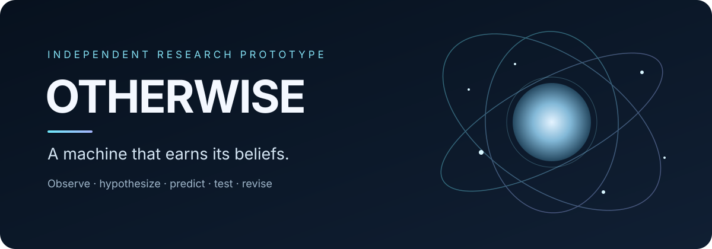

# Otherwise

**An artificial scientist that must earn its beliefs.**

Otherwise is an early-stage research prototype exploring whether a computational agent can infer hidden physical structure from noisy experiments, make predictions that risk being wrong, and revise its claims when evidence disagrees — without a language model deciding what is scientifically true.

> **Project status:** research prototype. This public repository is an overview and research-notes release. It does **not** contain the private engine source, canonical scientific memory, or sealed evaluation worlds.

## Research question

Can an artificial scientist discover useful structure in a world whose governing rules are hidden from it, and can it tell the difference between a model that fits current data and one that predicts new observations?

The current work studies this question in controlled synthetic mechanics. It does not claim validated real-world scientific discovery or open-ended general intelligence.

## Research loop

1. Observe noisy measurements from a controlled world.
2. Generate and compare quantitative hypotheses.
3. Account for fit, uncertainty, and model complexity.
4. Derive a prediction that could be wrong.
5. Select a discriminating experiment.
6. Inspect prediction error and residual structure.
7. Revise or retain claims while preserving provenance.

The key boundary is between the **scientific engine** and an **optional language interface**. The engine owns measurements, fitting, hypothesis comparison, predictions, and scientific claim status. A language model may help interpret a request or explain a recorded result, but it is not the authority that decides which law is true.

## What exists today

### Primary prototype

The primary Otherwise prototype has a research loop for controlled mechanics experiments, including drop, pendulum, and orbital-style investigations; quantitative hypothesis fitting and comparison; prediction checks; experiment selection; anomaly and residual inspection; and persistent records of observations, claims, questions, and research decisions.

### Frontier research branch

A separate experimental branch explores a harder problem: what happens when a scientist's existing hypothesis language is too narrow to express the world's mechanisms? In this branch, the world simulator and the agent run separately; the agent should receive only allowed observations and instrument responses, while hidden truth stays sealed until post-run evaluation.

In a developer-authored development world, a recorded run completed 275 experiments in about 7.5 seconds and inferred material-inertia ratios reported by the developer to be within roughly 1–2% of sealed values. The development work also identified two interaction channels and candidate latent cyclic-phase and continuous-direction structures. These are preliminary development-world results, not independent validation.

A separate held-out evaluation fell below the existing acceptance bar and missed effects including spatial field build-up, velocity-dependent interaction, and screening. The acceptance threshold was not lowered to make the result pass. Frontier remains incomplete and is not an integrated replacement for the primary prototype or its existing interface.

## Evidence and limitations

| Question | Current status |
|---|---|
| Can the prototype conduct experiments in controlled synthetic mechanics? | Implemented in the research prototype. |
| Can it fit quantitative hypotheses, compare alternatives, derive predictions, and revise claims? | Implemented within its current model families. |
| Can it identify structure in developer-authored Frontier worlds? | Preliminary positive development results; not independently audited. |
| Does it generalize reliably to unseen, out-of-grammar worlds? | Not established; held-out failures remain. |
| Has it discovered or validated new real-world physics? | No such claim is made. |
| Is its hypothesis language open-ended? | No. Representation growth remains an active research problem. |

Figures in this repository are developer-reported outcomes from controlled simulations. They have not been peer-reviewed or independently reproduced. Performance in development worlds and generalization to held-out worlds are different claims and must be assessed separately.

Read [the research evidence](docs/SCIENTIFIC_EVIDENCE.md), [architecture overview](docs/ARCHITECTURE.md), [proposed evaluation protocol](docs/EVALUATION_PROTOCOL.md), and [reproducibility status](docs/REPRODUCIBILITY.md).

## What this repository contains

- Public overview and architecture description.
- A cautious summary of recorded development results and known failure modes.
- A proposed evaluation protocol and reproducibility checklist.
- A concise [research brief](docs/RESEARCH_BRIEF.md).
- Roadmap, contribution guidance, and security/disclosure boundaries.

This is **not currently a runnable release of Otherwise**. Reproduction requires a separately prepared source release and run artifacts; those are not included here. The project will only be described as reproducible when the necessary versioned code, dependencies, commands, seeds, and evaluation outputs are released and checked.

## Research priorities

1. Improve representation growth when the existing model grammar cannot express a mechanism.
2. Detect structural model inadequacy instead of treating every large residual as a parameter-fitting problem.
3. Measure the full cost of research actions, including refits and world time they trigger.
4. Preserve immutable observations and versioned claims with provenance, status histories, and recoverable checkpoints.
5. Evaluate across held-out worlds using fixed criteria, reporting failures and inconclusive tests.
6. Audit optional language interfaces for numerical fidelity and preservation of uncertainty and claim status.

## Request for feedback

I am seeking technical critique of the evaluation methodology, suitable benchmarks, reproducibility advice, and potential research collaboration. Computational or API support would be useful only for a clearly scoped study; it is not a substitute for the independent scientific engine.

**Contact:** otherwise532@gmail.com  
**Maintainer:** Mehran, independent developer

## Watch the project demo

**[Open the full demo video in Google Drive](https://drive.google.com/file/d/19uXbnbMJ5aixH4LPPKdj9gkZ6Q7oDLCH/view?usp=drive_link)**

The recording shows the primary Otherwise prototype: its scientific-world view, experiment activity, control-room/scientist panels, and persistent research record. This is a demonstration of the primary prototype, not an integrated Frontier 3D interface. The private engine source and sealed evaluation materials are intentionally not included in this repository.

If the preview image does not appear to visitors, check the file’s Google Drive sharing setting and set **General access → Anyone with the link → Viewer**.

## Repository boundaries

The underlying project source and some evaluation assets remain private. This repository licenses only the documentation explicitly covered by [LICENSE-DOCS.md](LICENSE-DOCS.md); it does not grant a license to source code or material that is not included. See [Security and Disclosure](docs/SECURITY_AND_DISCLOSURE.md) before proposing or publishing evaluation assets.
